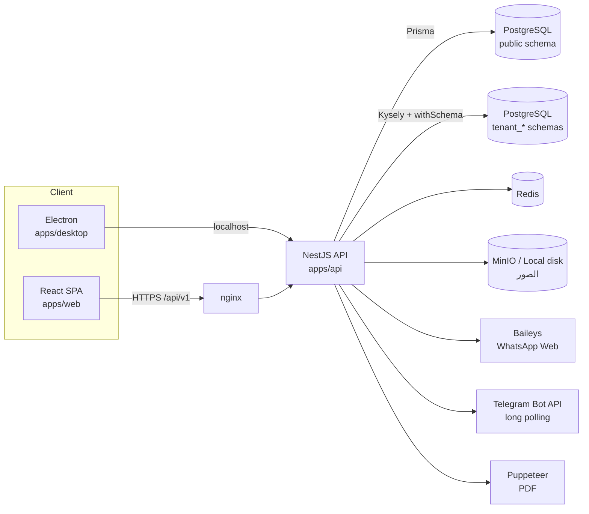

# نبغة — المعمارية (المرجع الرسمي)

> **الحالة:** معتمد · **آخر تحديث:** 2026-11-25 · مرجع تفصيلي قديم: [`../MASTER_DOC.md`](../MASTER_DOC.md)

## 1. المنتج في سطور

نبغة برنامج إدارة للمدرسين الخصوصيين والسناتر في مصر. بيغطي:
- الطلاب والمجموعات والحصص والحضور بالباركود.
- الدرجات وبنك الأسئلة والامتحانات والتسميعات.
- المالية: المستحقات والتحصيل والخزن والمصروفات.
- التقارير.
- إشعارات أولياء الأمور على **واتساب** و**تليجرام**، وبوابة لولي الأمر.

**العميل الحالي:** مدرس واحد (ممكن يدرّس أكتر من مادة) ومعاه مساعدينه.
لسه مفيش مراكز خارجية بأكتر من مدرس. ده بيأثر على تصميم حاجات زي بنك الأسئلة ([ADR-0004](../adr/0004-shared-question-bank.md)).

## 2. أوضاع التشغيل

| الوضع | `DEPLOY_MODE` | فين | ملاحظات |
|---|---|---|---|
| Desktop | `desktop` | جهاز العميل (Windows) | Electron بيشغّل الـ API كـ child process + PostgreSQL محلي. التثبيت والتحديث بـ NSIS installer. الـ migrations بتشتغل مع كل تشغيل. |
| LAN | `local` | سيرفر في السنتر | nginx + HTTPS، والأجهزة بتوصل على الشبكة المحلية. |
| SaaS | `saas` | سيرفر سحابي | حالياً: `https://nabgha.tcronix.com` (فيه المركز التجريبي). |

**في كل الأوضاع:** كل مركز (tenant) ليه **schema منفصلة** في PostgreSQL اسمها `tenant_<uuid بـ _ بدل ->`.

## 3. الصورة العامة



## 4. Monorepo

| المسار | المحتوى |
|---|---|
| `apps/api` | NestJS 11. الموديولات في `src/modules/*`، والبنية التحتية المشتركة في `src/shared/infrastructure/*`. |
| `apps/web` | React 18 + Vite + Tailwind + shadcn/ui (RTL، خط Cairo). كل feature في `src/features/*`. |
| `apps/desktop` | Electron 29. |
| `packages/db` | Prisma schema (public) + SQL migrations (`src/migrations/{public,tenant}`) + `kysely-types.ts` + `migrate.js`. |
| `packages/types` | أنواع وثوابت مشتركة (الصلاحيات، `GRADE_OPTIONS`…). |
| `scripts/demo` | تعبئة المركز التجريبي ([DEMO_TENANT](../operations/DEMO_TENANT.md)). |
| `apps/api/test/scenarios` | اختبارات السيناريوهات ([TESTING](../engineering/TESTING.md)). |

الأدوات: Turborepo + pnpm 10، وNode 20+.

## 5. الـ Backend

### 5.1 بنية الموديول (Clean Architecture مبسّطة)
```
modules/<name>/
  domain/          entities + repository interfaces
  application/     use-cases + dtos (zod) + services
  infrastructure/  repositories (Kysely)
  presentation/    controllers
```

### 5.2 الوصول للبيانات
- **public schema** (المراكز والخطط ومستخدمي المنصة): Prisma.
- **tenant schemas:** Kysely. `kysely.getTenantDb(tenantId)` بيرجّع instance عليه `withSchema(...)`، وده بيضيف اسم الـ schema لأي جدول في الـ query builder.
- ⚠️ **الـ `sql\`\`` الخام ودوال plpgsql مش بياخدوا الـ schema تلقائي.** الاتصال نفسه شغال على `search_path = public`. التفاصيل والحلول في [CONVENTIONS §2](../engineering/CONVENTIONS.md#2-قاعدة-البيانات).

### 5.3 الأمان والصلاحيات
- **سلسلة الـ guards الإلزامية:** `JwtAuthGuard → TenantGuard → RolesGuard → PermissionGuard`، والصلاحية بتتحدد بـ `@RequirePermission('module.action')`.
- **نوعين توكنات:**
  - `tenant` و`platform`، وكل واحد بسر مختلف.
  - الـ refresh token فيه `tokenUse: 'refresh'` ومينفعش يتستخدم للدخول على الـ API.
  - التجديد بيراجع المستخدم والمركز والصلاحيات من قاعدة البيانات. التفاصيل في [modules/AUTH.md](../modules/AUTH.md).
- **الأخطاء:**
  - `AppError(code, message, status)`.
  - `GlobalExceptionFilter` بيترجم أخطاء PostgreSQL (UUID غلط، تكرار، بيانات مرتبطة) لـ 400/409 برسائل عربي (CORE-001).

### 5.4 المهام الدورية (Cron)

| المهمة | الموعد | الملف |
|---|---|---|
| توليد مستحقات الشهر (مرة لكل شهر لكل مركز، بتلحق لو الجهاز كان مقفول) | `5 * * * *` | `finance.usecase.ts` |
| تذكير المتأخرين في الدفع (مرة في اليوم لكل مركز) | `0 10-20 * * *` | `finance.usecase.ts` |
| مطابقة رصيد التعويض اليومية | `20 * * * *` (فعلياً مرة في اليوم) | `session.usecase.ts` |
| نسخ احتياطي (ديسكتوب بس، لو آخر نسخة أقدم من 24 ساعة) | `40 * * * *` + بعد التشغيل بـ 3 دقايق | `scheduled-backup.usecase.ts` |
| إعادة إرسال رسائل واتساب الفاشلة | كل 10 دقايق | `retry-failed-messages.usecase.ts` |
| الإرسال الجماعي في الخلفية | كل دقيقة | `send-bulk.usecase.ts` |
| مراقبة صحة اتصال الواتساب | كل 5 دقايق + نص الليل | `wa-health-monitor.usecase.ts` |

القاعدة: أي مهمة دورية لازم تبقى **idempotent** وتستحمل إن الجهاز يكون مقفول وقت موعدها (عملاء الديسكتوب).

### 5.5 خدمات مشتركة مهمة

| الخدمة | المسار | ملاحظات |
|---|---|---|
| `PdfExportService` | `shared/infrastructure/export/pdf-export.service.ts` | متصفح Puppeteer واحد بيتشغّل أول ما يتطلب، وفيه حد أقصى 3 مهام في نفس الوقت. `renderHtml()` بتمنع أي طلب شبكة غير `data:`. |
| `EMBEDDED_CAIRO_CSS` | `shared/infrastructure/export/embedded-cairo.font.ts` | خط Cairo مضمّن (OFL) عشان الـ PDF يطلع عربي سليم أوفلاين ([ADR-0006](../adr/0006-embedded-pdf-font.md)). |
| `StorageService` | `shared/infrastructure/storage/storage.service.ts` | الديسكتوب بيحفظ على الديسك، والسيرفر على MinIO. الروابط بتبقى `/storage/...`، و`getFileBuffer` شغالة في الوضعين. |
| `normalizePhone` / `phoneVariants` | `shared/utils/phone.util.ts` | توحيد أرقام مصر لـ `20…`، وكل الصيغ المتخزنة. |
| `normalizeScannedCode` | `shared/utils/student-code.util.ts` | تصليح كود السكانر (كيبورد عربي، QR قديم JSON، أرقام عربي) ([BARCODES](../modules/BARCODES.md)). |

## 6. الـ Frontend
- React Query لكل الـ server state، و`apiClient` (axios) بيعمل refresh تلقائي ودوران للتوكنات.
- كل feature فيها `api/` و`hooks/` و`components/` و`pages/` و`types/`.
- PWA فيها service worker (`public/sw.js`). أي تغيير في أصول ثابتة زي الشعار محتاج نزوّد رقم الكاش.
- ⚠️ فيه حوالي 84 خطأ TypeScript قديم (WEB-TS-001). الـ build بيعدّي لأن Vite مش بيعمل type-check. **القاعدة:** ماتزوّدش أخطاء جديدة.

## 7. قاعدة البيانات
- **الـ migrations:**
  - `packages/db/src/migrations/tenant/NNN_*.sql`، ولحد دلوقتي وصلنا لـ **029**.
  - الـ public: `public/001_initial.sql`.
  - السجل في `<schema>.schema_migrations`.
- **الديسكتوب:** `migrate.js` بيشتغل مع كل تشغيل للبرنامج.
- **السيرفر:** بنطبّق الـ migration الجديدة بإجراء محدد على كل مركز ليه سجل migrations ([RUNBOOK §4](../operations/DEPLOYMENT_RUNBOOK.md#4-تطبيق-migration-جديدة)). مش بنشغّل `migrate.js` على السيرفر بسبب مركز `my-center` القديم.
- قايمة الـ migrations الحديثة:

| # | الغرض |
|---|---|
| 024 | بنك الأسئلة والامتحانات (`exam_questions`، `exams`، `exam_items`). الـ GRANT بقى مشروط (DB-001، [ADR-0011](../adr/0011-db-001-conditional-grant.md)). |
| 025 | قيد عكس المصروف في الخزينة (`expense_reversal`). |
| 026 | رصيد التعويض v2 (unique لكل حضور بديل، حالة `revoked`). |
| 027 | `exams.kind` (امتحان/تسميع)، و`sessions.exam_id`، و`sessions.out_of` بقى NUMERIC. |
| 028 | إصلاح trigger الـ `times_used` (اسم الـ schema). |
| 029 | `wa_chat_messages` — صندوق وارد الواتساب (WA-110). |

## 8. التكاملات الخارجية

| التكامل | الطريقة | التوثيق |
|---|---|---|
| واتساب | Baileys (WhatsApp Web)، رقم واحد لكل مركز، وكل الإرسال بيعدّي من طابور واحد بحماية من الحظر | [modules/WHATSAPP.md](../modules/WHATSAPP.md) |
| تليجرام | Bot API بـ long polling، قناة مستقلة ومحادثة في الاتجاهين | `MASTER_DOC §10` |
| PDF | Puppeteer (Chromium) | §5.5 |
| السكانر | كيبورد USB (HID) أو كاميرا (`html5-qrcode`) | [modules/BARCODES.md](../modules/BARCODES.md) |

## 9. حدود معروفة ومهمة
- الأسرار الثابتة في `apps/desktop/src/main.ts`: قرار مقصود من المالك ([ADR-0002](../adr/0002-fixed-desktop-secrets.md)).
- مفيش CI لحد دلوقتي، والاختبارات بتتشغّل يدوي ([TESTING](../engineering/TESTING.md)).
